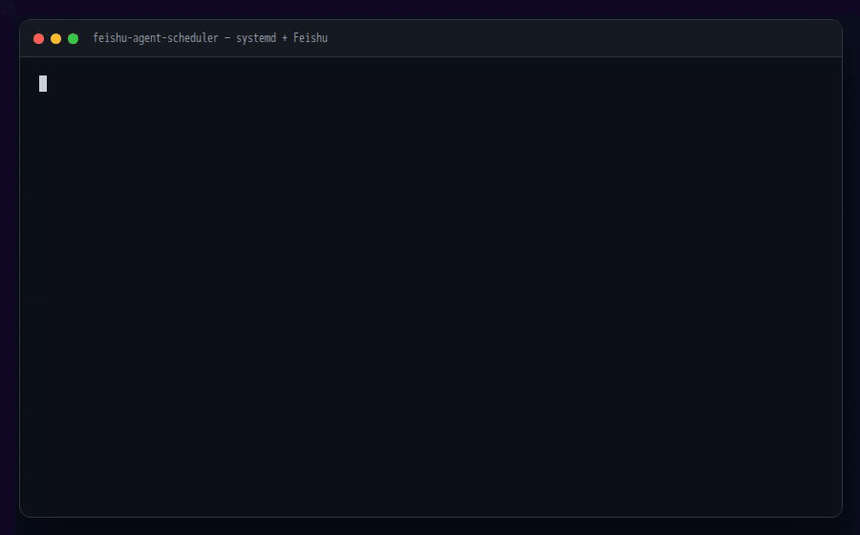

# feishu-agent-scheduler

[](https://github.com/zzszmyf/feishu-agent-scheduler/actions/workflows/ci.yml)
[](https://github.com/zzszmyf/feishu-agent-scheduler/releases)
[](LICENSE)
[](https://www.freedesktop.org/software/systemd/man/systemd.timer.html)

Schedule non-interactive Claude Code jobs with systemd user timers and push the result to Feishu/Lark with `lark-cli`.

This is the "cron for coding agents" pattern:

```text
systemd timer
  -> feishu-agent-run-job <job>
  -> claude -p <prompt>  (in a workspace, with a tool allow-list)
  -> lark-cli im +messages-send
  -> Feishu DM / group
```

It is intentionally small: no server, no database, no daemon. Job definitions are environment files; schedules are systemd timers; logs are plain files.

## Features

- Add / remove / enable / disable jobs
- `OnCalendar` schedules via systemd user timers
- Per-job workspace, prompt file, tool allow-list, timeout, push policy
- `always` / `failure` / `nonempty` push modes
- Silent marker (`[SILENT]`) for healthy runs
- `flock` prevents overlapping runs
- Idempotency key on the Feishu message
- Log retention

## Demo



Animated terminal rendering of the basic flow: add a job, list jobs and the next timer, then read the last run log. Static frame: [`docs/demo.png`](docs/demo.png).

## Requirements

- Linux with systemd user services
- Claude Code CLI (`claude`)
- `lark-cli`, authenticated for the bot/app identity
- `flock` (util-linux)

## Install

```bash
git clone https://github.com/zzszmyf/feishu-agent-scheduler.git
cd feishu-agent-scheduler
install -m 755 bin/feishu-agent-schedule ~/.local/bin/
install -m 755 bin/feishu-agent-run-job ~/.local/bin/
```

Make sure `~/.local/bin` is in `PATH`.

Create the optional agent environment file (never commit it):

```bash
mkdir -p ~/.config/feishu-agent
cat > ~/.config/feishu-agent/agent.env <<'EOF'
# ANTHROPIC_BASE_URL=...
# ANTHROPIC_AUTH_TOKEN=...
# ANTHROPIC_MODEL=...
EOF
chmod 600 ~/.config/feishu-agent/agent.env
```

## Find a target

A target is either a user open_id or a chat_id:

```text
user:ou_xxxxxxxxxxxxxxxx
chat:oc_xxxxxxxxxxxxxxxx
```

Use `lark-cli` to search for a group:

```bash
lark-cli im +chat-search --query "运维告警"
```

For your own DM, use your user open_id. The scheduler deliberately has no hard-coded owner; pass `--target` or set `FEISHU_AGENT_DEFAULT_TARGET`.

## Add a job

```bash
feishu-agent-schedule add daily-health \
  --calendar "*-*-* 09:00:00" \
  --prompt-file examples/jobs/daily-health.prompt.txt \
  --workspace "$HOME/agent-workspace" \
  --target user:ou_xxxxxxxxxxxxxxxx \
  --tools "Bash Read Grep Glob" \
  --timeout 15m \
  --push always
```

Test it once (this actually sends a Feishu message):

```bash
feishu-agent-schedule run daily-health
feishu-agent-schedule logs daily-health 80
```

List jobs and timers:

```bash
feishu-agent-schedule list
systemctl --user list-timers 'feishu-agent-job-*.timer' --no-pager
```

## Job options

| Option | Description |
|---|---|
| `--calendar <expr>` | systemd `OnCalendar` expression |
| `--prompt <text>` | inline prompt |
| `--prompt-file <path>` | prompt from a file |
| `--workspace <path>` | working directory, default `~/agent-workspace` |
| `--target <spec>` | `user:ou_...` or `chat:oc_...` (required) |
| `--tools <list>` | allowed tools, default `Read Grep Glob`; `bypass` for full access |
| `--timeout <duration>` | per-run timeout, default `15m` |
| `--push <mode>` | `always`, `failure`, or `nonempty` |
| `--silent-marker <s>` | skip push when output contains this, default `[SILENT]` |
| `--no-enable` | write files but do not enable the timer |

## Push modes

- `always`: send the result on success and failure.
- `failure`: send only when the exit code is non-zero.
- `nonempty`: send only when the output has non-whitespace content.

If the output contains the silent marker, the push is skipped regardless of mode. This is useful for hourly checks:

```text
检查服务状态。正常只回复 [SILENT]；异常详细说明。
```

## Files

```text
~/.config/feishu-agent/jobs/<job>.env
~/.config/feishu-agent/jobs/<job>.prompt.txt
~/.config/systemd/user/feishu-agent-job@.service
~/.config/systemd/user/feishu-agent-job-<job>.timer
~/.local/state/feishu-agent/jobs/<job>/*.log
```

## Security

- The job runner executes `claude -p` with the permissions you grant. Treat it as a remote shell.
- Default allow-list is read-only: `Read Grep Glob`.
- `--tools bypass` is dangerous; use it only in a disposable workspace.
- Never commit `~/.config/feishu-agent/agent.env`, job files containing chat IDs, or logs.
- Job prompts can contain internal hostnames, tokens, or customer data. Keep those out of public repos.
- The Feishu message is sent with the bot/app identity configured in `lark-cli`.

## Limitations

- systemd user timers require the user session to be alive; use `loginctl enable-linger` if needed.
- This is not a distributed scheduler; it is for a single machine.
- `lark-cli` must be authenticated before the timer runs.
- No retry queue: if the Feishu send fails, the log records it; the next run is independent.

## 中文快速开始

```bash
feishu-agent-schedule add daily-health \
  --calendar "*-*-* 09:00:00" \
  --prompt-file examples/jobs/daily-health.prompt.txt \
  --target user:ou_你的open_id \
  --tools "Bash Read Grep Glob" \
  --push always
```

正常返回 `[SILENT]` 就不推送；异常才发飞书。任务定义在 `~/.config/feishu-agent/jobs/`，日志在 `~/.local/state/feishu-agent/jobs/`。

## Related

Part of [feishu-agent-stack](https://github.com/zzszmyf/feishu-agent-stack) — tools for running coding agents from Feishu/Lark. See also [`cc-session`](https://github.com/zzszmyf/cc-session) for persistent interactive sessions and [`pi-managed-agents`](https://github.com/zzszmyf/pi-managed-agents) for managed sessions and sandboxes.

## License

MIT
